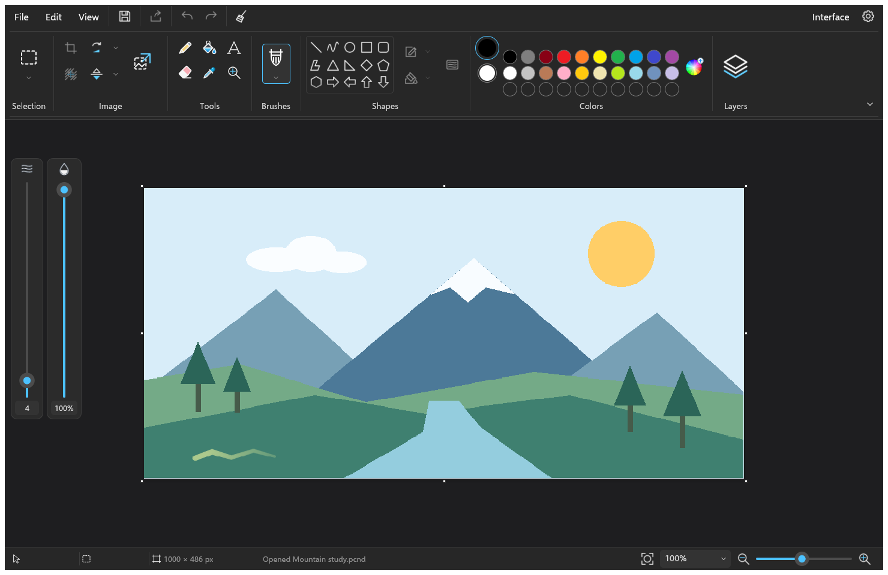
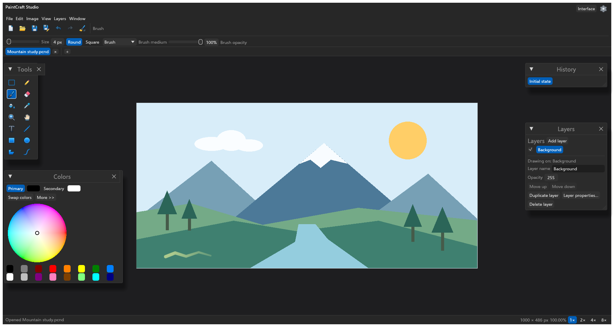
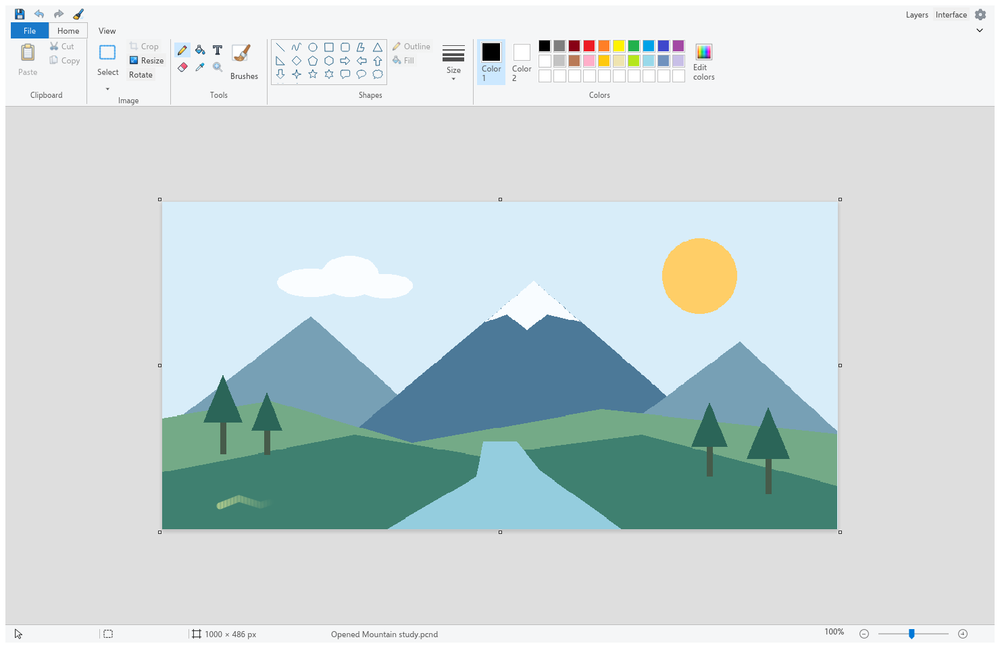
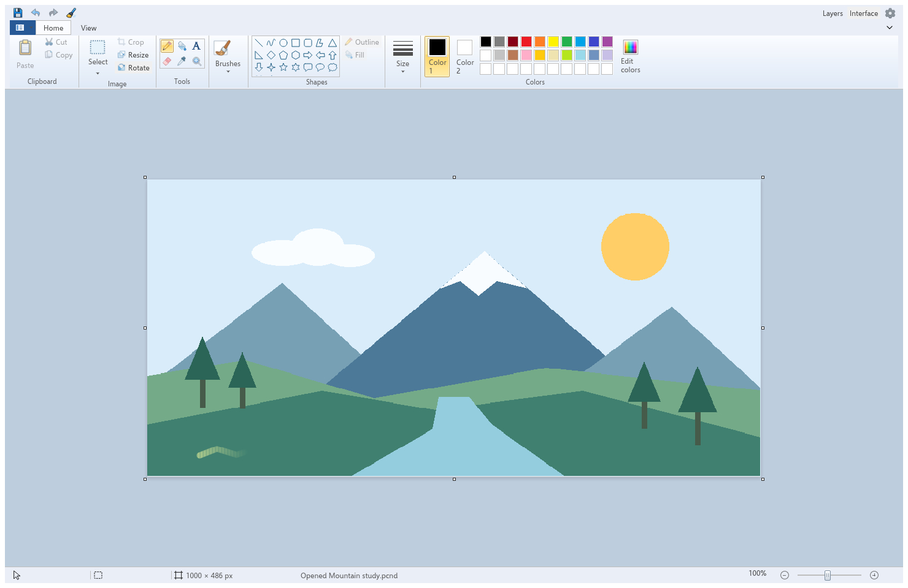

# PaintCraft

A familiar place to draw, paint and edit images. Built in Rust.

- Windows 7, 10 and 11 Classic skins.
- Studio with document tabs, Save All and floating panels.
- Six editable point filters in Studio: Invert, Brightness/Contrast, Black & White, Threshold, Posterize and Solarize, with saved selection masks and live previews.
- Desktop, browser and command-line apps.
- **MCP support:** let AI assistants paint, edit layers, preview images and save projects.
- Nine brushes, pencil, eraser, fill and color picker.
- Pen pressure controls for size and opacity, with native macOS and browser input.
- Shapes, curves and text.
- Rectangular and free-form selections, copy and cut.
- Paste images onto the canvas or into new layers (macOS and supported browsers).
- Layers, flattening, undo/redo, crop, rotate and flip.
- Recent files with quick reopening.
- Native printing on macOS.
- Light and dark themes in seven languages.

Click **Interface** in the top right to switch between **Classic** and **Studio** and try both. In Classic, choose a Windows 7, 10 or 11 skin in **Settings**.

| Classic, Windows 11 | Studio |
| --- | --- |
|  |  |

| Classic, Windows 10 | Classic, Windows 7 |
| --- | --- |
|  |  |

## Paint with MCP

Connect your MCP client to PaintCraft to create canvases, paint with brushes and shapes, edit layers, undo changes, import pictures and save or export the result.

```sh
cargo run --release -p paintcraft-cli -- mcp
```

[Set up your MCP client](docs/MCP.md). Each connection works on its own headless document.

## File formats

**PCND (`.pcnd`)** is PaintCraft's compact, lossless project format. It keeps layers, transparency, editable filters, their masks and canvas size intact, while being compressed and lightweight. Save as PCND to keep working on your project.

- **Classic and Studio:** open and export PNG, JPEG, BMP, still GIF and single-page TIFF.
- **PNG source details:** keep original profile and resolution information in projects, or omit it from exported PNG copies.
- **TIFF page import:** choose a supported page in desktop/browser Studio, CLI or MCP after reviewing color-depth and metadata losses.
- **Studio:** also open and export TGA, still WebP and supported 2D DDS images.
- **DDS texture export:** choose compression and generate smaller texture levels in desktop/browser Studio, CLI or MCP; Studio previews the result.
- **Studio exports:** lossless JPEG XL, lossy AVIF, QOI, PAM, farbfeld and PCX with optional 256-color palettes and a preview.
- **JPEG XL import:** Studio on desktop and in your browser, CLI and MCP can import supported still pictures.
- **JPEG XR pictures:** import supported pictures in desktop Studio, CLI and MCP; export supported lossless copies without transparency on Windows, macOS and Linux.
- **HEIC/HEIF import:** native Studio, CLI and MCP can import supported sRGB pictures with transparency after reviewing any color or metadata losses.
- **AVIF import:** native Studio, CLI and MCP can import supported sRGB pictures with transparency from a complete installation.
- **HDR/EXR conversion:** preview supported pictures in native Studio; CLI and MCP offer the same exposure and tone settings for conversion to 8-bit images.
- **Extra imports in Studio:** QOI, Netpbm, farbfeld and PCX, plus a selected DCX page or ICO/CUR entry.
- **DCX export:** save a single-page copy through the native CLI or MCP.
- **Historical MSP:** import monochrome Paint pictures in Studio, CLI and MCP; export exact opaque black-and-white MSP1 or MSP2 copies.
- **Icon export in Studio, CLI and MCP:** multi-size ICO/CUR files with PNG or bitmap entries and cursor hotspots.
- **Apple icons:** import a chosen ICNS entry and export new icon sets with explicit sizes and Retina scale in Studio, CLI and MCP.
- **Layered imports:** Studio imports OpenRaster (`.ora`) layers and converts supported groups into layers after a warning. It also opens a limited historical Paint.NET (`.pdn`) subset as converted copies. Studio also imports a limited Windows Paint (`.paint`) subset. Save converted projects as PCND; writing PDN or PAINT is not supported.
- **Photoshop imports in Studio:** basic PSD/PSB raster layers with names, positions, opacity and visibility. Save converted copies as PCND.
- **SVG/SVGZ:** import a picture at your chosen size, DPI and fitting, with your own font files, in Studio, CLI or MCP.
- **Palettes:** import/export Adobe Swatch Exchange (`.ase`) in Studio, CLI and MCP.
- **Custom shapes:** import/export Adobe `.csh` resources in Studio, CLI and MCP; draw supported filled presets or place them at an exact size in Studio.
- **ABR brushes:** choose supported static tips in Studio, or inspect and paint with them through CLI and MCP.

Image exports flatten layers. Conversion prompts explain supported losses such as reduced color depth, palette changes or discarded metadata. See [format support and limits](docs/FORMAT_INTEROPERABILITY.md) for the supported subsets.

## Install

See [Releases](https://github.com/replicraft/PaintCraft/releases) for packaged downloads and installation notes. Choose the build for your operating system and processor. On macOS, open the DMG and drag PaintCraft to Applications. On Windows, use the MSI or extract the portable ZIP.

The [CLI installer](docs/RELEASING.md#headless-cli-distribution) installs the command line app and its required files together. It requires Python 3.12 or newer and also supports building from source.

## Run

Desktop:

```sh
cargo run --release -p paintcraft
```

Command line:

```sh
cargo run --release -p paintcraft-cli -- --help
```

Browser:

```sh
pnpm --dir apps/paintcraft-web install --frozen-lockfile
pnpm --dir apps/paintcraft-web run dev
```

Open [localhost:8088](http://localhost:8088).
