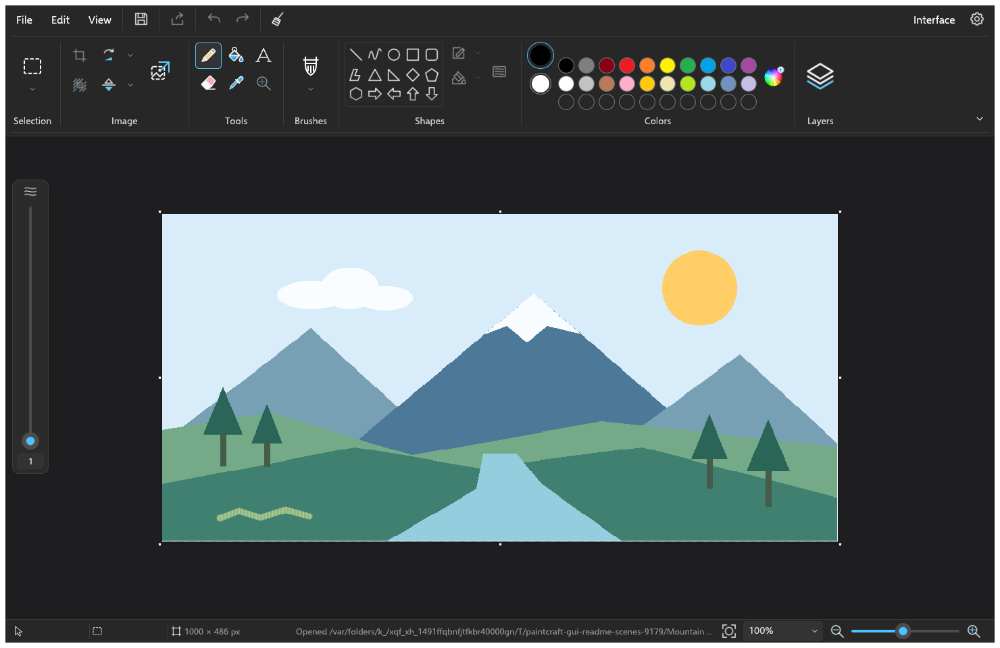
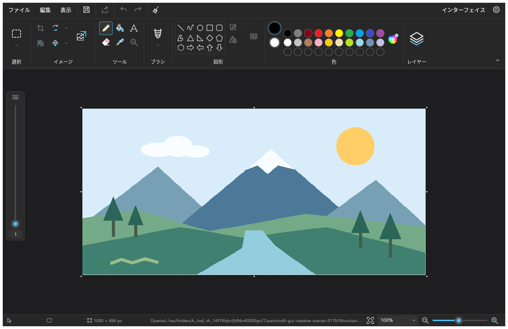

# PaintCraft

A familiar place to draw, paint and edit images.

Choose **Classic** for the feel of Windows Paint, or **Studio** for a layered
workspace with floating tool panels. PaintCraft is an early preview and is still
being built.

## Make something

- Draw with pencil, eraser, fill and nine brush styles, including calligraphy,
  airbrush, oil, crayon, marker and watercolor.
- Add shapes, polygons, curves and antialiased text.
- Pick colors from your image and keep a custom palette.
- Select, crop, resize, rotate and flip your work.
- Organize artwork with layers, visibility and opacity.
- Undo and redo edits, save projects, and open or export PNG, BMP and JPEG images.

## Make it yours

Classic includes Windows 7, 10 and 11 skins, light and dark themes, canvas defaults
and a default text font. Settings includes English and Japanese. Studio keeps its
own document workspace, with Save or Discard before switching interfaces.

*Classic, Windows 11 skin.*

*Japanese interface with the same drawing tools.*

## Desktop, browser and automation

The desktop app uses native file dialogs and includes crash recovery. The
[browser editor](apps/paintcraft-web/README.md) provides Classic drawing, layers,
text, project downloads and PNG export. A command-line companion supports image
editing and conversion without opening a window.

[Getting started and development](docs/DEVELOPMENT.md) ·
[Current progress](docs/ROADMAP_STATUS.md) · [License](LICENSE)
