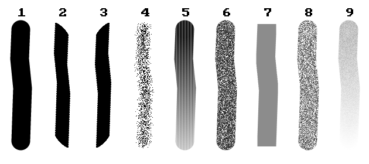

# Classic follow-up, October 24, 2026

This is the work record for the latest Classic feedback. It does not replace the
feature roadmap or claim native Paint parity.

## Implemented

- Arial is the default text family. Native font discovery retains Arial when
  installed and resolves an unavailable Arial default to bundled Selawik. Explicit
  other family preferences survive discovery. Interface text still uses Selawik;
  the browser retains its bundled font default.
- Stroke size paints its glyph at the center of its actual button rectangle.
- Classic initially fits the canvas using the Zoom to Window calculation. A
  restored explicit view scale takes precedence; new/opened documents fit again.
- Classic images up to 1 megapixel and 2048 pixels on either side reuse a complete
  level-zero texture across idle zoom changes. Magnified live painting/text and
  queued edits retain regional rendering to avoid widening preview work. Larger
  images retain bounded regional
  display requests. This reduces render work; native end-to-end latency is not
  benchmark-qualified by this change.
- The checkerboard is submitted as one mesh. Scrollbar geometry changes schedule
  the next frame instead of repeatedly discarding the current layout. A regression
  toggles Layers six times at both display scales and checks settled frames for
  discard requests and the egui performance banner.
- Delete in the Selection menu and the Delete shortcut erase the active layer's
  selected pixels to Classic's canvas ground. Other frontends may capture a
  transparent clearing color. No selection is a no-op. Desktop/browser use the
  same replacement-fill command; Undo restores document and selection.
- Historical ribbons now expose Outline, Fill and Size alongside their shapes.
  They retain their own image controls and do not advertise newer AI controls.
- Classic tooltips, selection rows, dialog buttons, chooser subtitle, shape
  choices, units and shared confirmation buttons use Fluent translations.
- The picker has a narrower glass tube and shorter blue bulb, following the
  supplied Paint reference. Its shared and theme-specific SVGs were updated.
- The README contains feature bullets, actual application screenshots and run
  commands. Images are in `assets/repo`; renderer/source notes stay in docs.

## Localization and historical skin follow-up

- Added Fluent arguments for tool sizes, font counts, opacity, canvas dimensions,
  history rows and recovery messages. Values such as font names and filenames are
  preserved. Classic, Studio and browser controls now translate the reported
  menu labels, text preference counts, tooltips and accessible names.
- Translation functions and language types are imported at file scope. The CI
  translation check catches missing literal entries and mismatched Fluent
  arguments in English/Japanese. It does not prove that arbitrary English prose
  outside translation calls is covered. Low-level diagnostic payloads retain
  their original details inside translated status envelopes.
- Windows 7/10 now use dedicated compact Home/View ribbons instead of the v11
  menu arrangement. Clipboard, Image, Tools, Shapes and Colors follow the supplied
  reference grouping; brushes have separate primary and dropdown interactions.
  Brushes and Size occupy their own ribbon columns, with line-width samples
  and a custom numeric entry in Size.
- Historical colors use side-by-side square Color 1/Color 2 wells, exactly ten
  custom palette slots and a rainbow rectangle for Edit Colors. Their seven-column
  shape gallery uses small blue outlines. Windows 7 has its blue application menu,
  pale ribbon gradient and gold selection treatment; Windows 10 has a flat gray
  ribbon and blue selections.
- Historical status strips are 22 points tall, with a compact percentage entry,
  circular minus/plus controls. Windows 7 uses a silver grip thumb in its light
  theme; Windows 10 retains its blue thumb. Their zoom actions and
  slider/touch handling retain shared editor behavior. Windows 11 keeps its own
  status presentation.
- Updated the actual offscreen captures in `assets/repo/classic-windows-7.png`
  and `assets/repo/classic-windows-10.png`. These include real edited document
  pixels; OS window borders and the macOS menu bar are outside the captures.

This improves the reference layout; it does not establish full skin or feature
parity. Some original artwork, native Windows window decorations and
version-specific details remain. Clipboard operations and
Magnifier remain explicitly disabled. Existing canvas centering is retained.

## Brush comparison

Inspected the author's actual numbered Paint stroke image in
[Rating Microsoft Paint brushes](https://spicymeatballsandwich.wordpress.com/2025/06/12/rating-microsoft-paint-brushes/)
and the first-hand illustrated
[Paint brush tutorial](https://cynmackley.com/2014/02/09/ms-paint-101-brush-and-color-selection/).
The numbered image was downloaded for visual inspection, not redistributed.
The following is PaintCraft's actual editor output, with all media at 32 pixels;
its dimensions and pointer path do not match the published Paint sample.

From left to right: Brush, Calligraphy brush, Calligraphy pen, Airbrush, Oil,
Crayon, Marker, Natural pencil, Watercolor. This also makes remaining differences,
such as the regularity of the oil bristles, visible for follow-up.

The visible airbrush sample has discrete particles, whereas PaintCraft had a
uniform radial wash. Airbrush now uses deterministic spray particles with radial
density. Oil/watercolor samples visibly taper/fade; their PaintCraft strokes now
lose charge with traveled distance and reset on the next gesture. Travel includes
clipped segments so viewport/selection clipping does not reset the material.

Calligraphy retains opposing diagonal nibs; marker retains its rectangular nib;
crayon and natural pencil retain different grain densities. These were visual
comparisons at uncontrolled sizes, not matched-input golden tests. Native Paint
version, pointer velocity, time-based spray accumulation, pigment mixing and wet
paper behavior remain unqualified. Existing preview/commit identity, clipping,
retracing, cancellation and resource bounds still apply.

## Still required by this feedback

1. Binary selection masks, free-form creation, inversion, floating movement and
   secondary-color-keyed transparent selection. Merely checking a menu item would
   not implement these behaviors. The current engine projection is rectangular.
   The [binary R8 storage foundation](SELECTION_MASKS.md) is implemented; its
   session/history/tool integration remains work.
2. Arbitrary-angle rotation with agreed resampling, bounds, selection and alpha
   rules across native, CLI and browser. Orthogonal rotations already work.
3. Subject-aware background removal. A border flood fill would not match Paint's
   subject detection, so it must not be substituted under that name.
4. Recent-file history, printing, scanner/camera acquisition, email/background
   integration, clipboard workflows, remaining historical artwork and
   version-specific behavior. Home/View ribbons and two-column File panels are
   implemented; full presentation or feature parity remains unqualified.
5. Remaining low-level diagnostic payload localization and continued
   localization/accessibility audits. Literal catalog checks do not establish
   complete prose coverage.
6. Sustained-input native zoom latency and matched-input Windows brush captures.

Crop already works after a nonempty canvas selection, across native/browser/CLI,
and has an end-to-end pixel/Undo regression. Without a selection its control
explains that an area must first be selected.

## Validation

The complete workspace run passed 1,205 tests with 60 ignored tests across 107
suites. The final native preview-region guard then passed all 230 ordinary GUI
tests (48 opt-in captures ignored), including magnified preview/release pixel
identity. The browser suite passed all 57 tests, including fitted startup,
selection erasure, crop and curve-preview release coordinates.

Workspace Clippy, WebAssembly Clippy and the final native all-target Clippy run
passed with warnings denied. The browser release distribution built successfully.
Four real offscreen application captures and a real editor brush sheet were
exported and visually inspected. These captures do not include OS window borders
or the native menu bar. Source length and whitespace checks passed.

An existing thumbnail cancellation test exposed a queued-versus-running race:
cancelling before the closure starts correctly drops its receiver. Its intended
running-job scenario now waits for a worker-start handshake. The targeted
thumbnail tests and complete workspace run pass with that synchronization.

Local raw evidence is archived in the ignored directory
`docs/validation/classic-feedback-2026-10-24/`. Live Windows latency, real tablet
input, complete translation coverage and native Paint golden comparisons are not
established by these checks.

The subsequent localization/ribbon workspace run passed 1,220 tests, with 60
opt-in tests ignored, across 108 suites. Workspace and WebAssembly Clippy passed
with warnings denied. The browser release distribution rebuilt successfully.
Updated offscreen captures were rendered and visually compared with the supplied
Windows 7 and Windows 10 reference folders. The final source checks also enforce
the 800-line limit and matching translation arguments. Raw follow-up logs are in
`docs/validation/ui-localization-skins-2026-10-24/` (ignored).

## Historical File panels and image export

Windows 7/10 now have a dedicated two-column File panel, with hover/click category
navigation, independently scrolling columns, normal-height Exit access, Escape
closure and a reset to Recent pictures when reopened. The Save as pane offers
PNG, JPEG and BMP copies plus a separate PaintCraft project save. GIF remains
explicitly disabled. Print, acquisition, email, desktop background and recent-file
integration remain unavailable rather than showing fabricated data or success.

Typed format actions select the native dialog's initial filename/filter and
missing-extension fallback. The returned filename extension remains authoritative.
The same choices now produce PNG, JPEG and BMP browser downloads using the existing
image codecs. Project association, pixels, history and dirtiness are unchanged by
export. Export confirmation explains flattening, invisible colors and JPEG loss;
existing files are untouched when cancelled. Browser downloads continue to be
unconfirmed copies rather than acknowledged persistent saves.

Application-supplied native file-dialog labels and the browser HTML download
prompt now receive English/Japanese strings from the selected UI language. The
platform crate stays independent of the UI translator. OS-supplied buttons still
use the host system's own language. Filenames are preserved as data.

The workspace run passed 1,226 tests with 60 opt-in tests ignored. Final focused
native File panel tests passed both skins and both languages with multipass
frames, byte signatures, decoded pixels, cancellation and unchanged project/history
checks. Browser menu/codec, UI metadata/catalog and platform tests passed 129 tests
with one ignored preview. Workspace/WebAssembly Clippy, browser release packaging,
JavaScript syntax, translation coverage, source length and whitespace checks passed.
The additional opt-in File capture rendered four real offscreen frames, reviewed
against the supplied references:

- `assets/repo/classic-v7-file-en-US.png`
- `assets/repo/classic-v7-file-ja.png`
- `assets/repo/classic-v10-file-en-US.png`
- `assets/repo/classic-v10-file-ja.png`

Raw logs are in `docs/validation/historical-file-panels-2026-10-24/` (ignored).
Actual OS picker interactions, live browser download/persistence behavior, native
Windows parity and a full native Japanese language review are not established by
these host tests and offscreen captures.

## Windows 7 reference refinement

Compared the larger `windows7/microsoft_paint.webp` reference and the detailed
`mspaint7-corner.png` against fresh offscreen editor captures. The historical
ribbon now has separate Tools, Brushes, Shapes and Size columns, a shorter group
footer and correctly positioned Select/Brushes disclosure triangles. The six
small tools sit in a bordered tray. Historical tool, selection, resize and rotate
artwork uses separate scalable SVGs instead of the modern icon sheet.

Windows 7 light-mode Pencil, shape and Color 1 selections use a glossy gold
surface with an inset highlight. The application button has a white menu glyph,
the selected Home/View tab meets the pale ribbon, the workspace is blue-gray and
the status zoom thumb is silver. Desktop and browser use the same skin-specific
workspace color. The canvas retains the requested centered placement. Windows 11
keeps its own ribbon and icon sources; Windows 10 shares the historical group and
artwork corrections but retains its flat selection treatment.

The updated `assets/repo/classic-windows-7.png` and
`assets/repo/classic-windows-10.png` are real editor renders. OS window chrome is
outside those captures. This is a closer presentation baseline, not a claim of
pixel-exact Windows 7 parity: remaining historical artwork, popup details and native platform differences
still need comparison.

Validation for this refinement: all 235 regular native GUI tests passed, with 49
opt-in captures ignored. The five focused historical UI tests also passed,
covering English/Japanese, light/dark themes and both display scales. Native
all-target Clippy passed with warnings denied; the WebAssembly target checked
and the browser release distribution rebuilt successfully. Both refreshed
historical screenshots were rendered offscreen and the Windows 7 capture was
visually compared with the supplied references. Translation, source-length and
whitespace checks passed. This does not qualify native Windows rendering parity.

## Historical shape gallery controls

The seven-column historical gallery now has the reference's narrow right-hand
rail: previous row, next row and an expanded chooser. The arrows scroll actual
shape rows and disable at the bounds. Wheel/trackpad scrolling and focus-driven
scrolling remain available. The expanded, square-cornered popup exposes all 23
existing shape choices using the historical blue outline artwork, selects the
real drawing tool and closes after a choice. English and Japanese labels cover
the new controls. This presentation is shared by Windows 7 and Windows 10;
Windows 11 retains its own gallery.

The new regression reaches Lightning through row scrolling and Heart through
the expanded chooser in both historical skins, languages and display scales,
including forced multipass input. It verifies unchanged document semantics and
history tickets after tool selection. The opt-in captures use normal frame
scheduling and assert that settled frames have no discard requests or performance
warning banner. Updated real captures include
`assets/repo/classic-v7-shapes.png` and `assets/repo/classic-v10-shapes.png`.

All 236 regular native GUI tests passed, with 50 opt-in captures ignored. Native
all-target Clippy passed with warnings denied, the browser release distribution
rebuilt, and translation/source-length/whitespace checks passed. Offscreen chooser
captures were inspected. Native Windows parity and keyboard Ribbon KeyTips remain
unqualified. Raw logs are in the ignored
`docs/validation/historical-shape-gallery-2026-10-24/` directory.

## Historical Brushes and Size dropdowns

Windows 7/10 Brushes now has a compact three-column grid for the nine brush media,
with a separate Square brush row below it. Every tile has a localized accessible
name and tooltip, shows selection and chooses the existing editor brush. The
samples reuse the original deterministic UI illustrations; they are not document
stroke previews or native Paint brush-accuracy evidence. Windows 11 retains its
larger list. The historical popup and trigger selection outlines use square
corners; Selection, Shapes and Size share the same historical popup styling.

The Size popup has separate left-aligned labels and right-side thickness samples,
explicit selected states, a localized current-value label for custom widths and
an accessible numeric entry. Pencil size remains independent of the other tools'
size. Both popups scroll in a 640 by 240 client area.

A directional-key regression exposed egui's default linear menu navigation:
Right did not move between brush tiles. Historical brush tiles now handle all
four arrow directions as a grid before the enclosing menu applies its linear
navigation. Enter chooses; Escape dismisses. Tests cover English/Japanese, both
historical skins, light/dark themes and normal/forced multipass rendering, and
verify that tool preferences do not publish document edits or history entries.

All 238 regular GUI tests passed, with 51 opt-in captures ignored. Native
all-target Clippy passed with warnings denied; the browser release distribution
rebuilt. Translation, source-length and whitespace checks passed. Actual
`assets/repo/classic-v7-brushes.png`, `classic-v7-size.png`,
`classic-v10-brushes.png` and `classic-v10-size.png` captures show the resulting
controls. The Windows 7 dropdowns and Windows 10 brush grid were visually
inspected. Full native Windows visual/behavioral parity remains unqualified.
Raw logs, including the original directional-navigation failure, are retained in
the ignored `docs/validation/historical-dropdowns-2026-10-24/` directory.

## Contextual historical text ribbon

Windows 7/10 now activate a Text tab with a green Text Tools indicator when the
Text tool is selected. It replaces the Home ribbon, retaining compact Font,
Background and Colors groups. Alignment is retained as a PaintCraft extension.
Home/View/Text tab changes keep the current tool and live text draft intact.
Selecting a different tool retires the contextual tab; reselecting Text activates
it again. Desktop and browser pass their existing text preferences and font
catalogs into the same borrowed UI contract.

The historical font family, size and formatting controls use 24-point hit targets
and smaller text, while Windows 11/Studio retain their larger controls. The font
search, virtualized list, IME/key handling, typed-size cancellation and text
renderer are reused. Opaque/Transparent use the existing secondary-color
background behavior. Desktop preference changes persist and update the live
draft without publishing document pixels. Native font discovery remains
asynchronous; browser font choices remain the bundled families.

The regression covers both historical skins, English/Japanese, light/dark themes
and normal/forced multipass rendering. It selects Selawik through font search,
chooses a size preset, toggles formatting/background, moves between the three
tabs while a draft exists, verifies unchanged document/history before placement,
and finally places the draft. Existing modern font-search, IME, popup and Escape
regressions also pass.

All 239 regular GUI tests and 59 browser library tests passed; 52 opt-in native
captures were ignored. Native all-target Clippy passed with warnings denied, the
browser release distribution rebuilt, and translation/source-length/whitespace
checks passed. Real `assets/repo/classic-v7-text.png` and
`assets/repo/classic-v10-text.png` captures were rendered offscreen and inspected.
Native Text Tools artwork, exact contextual-header geometry and full Windows
parity remain unqualified. Raw evidence is in the ignored
`docs/validation/historical-text-ribbon-2026-10-24/` directory.

## Historical Color 1/Color 2 workflow

The historical palette now has an active color well. A single click on Color 1
or Color 2 selects that target; left-clicking a standard or saved custom swatch
changes the selected color. Right-clicking a swatch continues to set Color 2.
The selected well has the skin's gold/blue treatment and accessible selected
state. Empty custom slots use the ribbon background, distinguishing them from
saved white colors. The 20 standard RGB values and named tooltips are retained;
palette accessible labels now translate the Color prefix in Japanese too.

Edit Colors follows the active well. An empty custom slot carries an explicit
primary/secondary target through the UI action outbox to the native/browser
staged editor. Cancel retains both colors and custom slots; OK adopts only the
intended color. Double-clicking a well or swatch opens its editor, and a saved
custom swatch retains its slot when reopened. These changes affect tool
preferences, not document pixels/history. Windows 11 keeps its existing
well-click behavior. The Edit Colors dialog itself still uses the shared Classic
presentation; native Windows 7/10 dialog fidelity is not claimed.

Native regressions cover both historical skins, English/Japanese, light/dark
and normal/forced multipass input, standard/custom swatches, acceptance,
cancellation and unchanged document/history. A separate pointer regression uses
60 Hz input to distinguish a custom-swatch double-click from the earlier well
activation, and verifies the existing slot is updated for Color 2. Browser UI
regressions exercise secondary custom-slot acceptance/cancellation in both
historical skins and languages. Action metadata checks verify unique primary and
secondary slot activation codes and frontend/modal gates.

The full native GUI run passed 240 regular tests; the final double-click
regression passed separately after its addition. All 60 browser library tests
and 27 shared UI tests passed, with one shared UI capture ignored. Native/web
all-target Clippy passed with warnings denied, the browser release distribution
rebuilt, and translation/source-length/whitespace checks passed. Real captures
are `assets/repo/classic-v7-color2.png` and `classic-v10-color2.png`; the Windows 7
capture was visually inspected. This does not establish pinned native Paint
behavioral parity. Evidence, including pointer-timing diagnostics, is retained in
ignored `docs/validation/historical-palette-2026-10-24/`.
